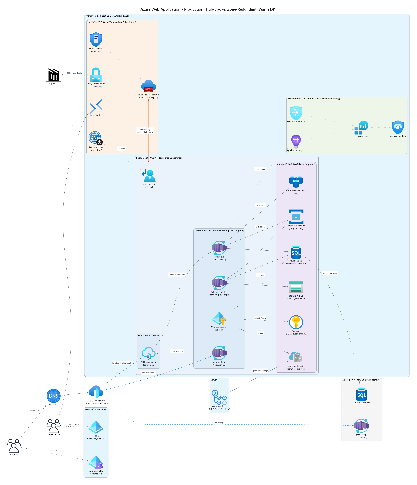
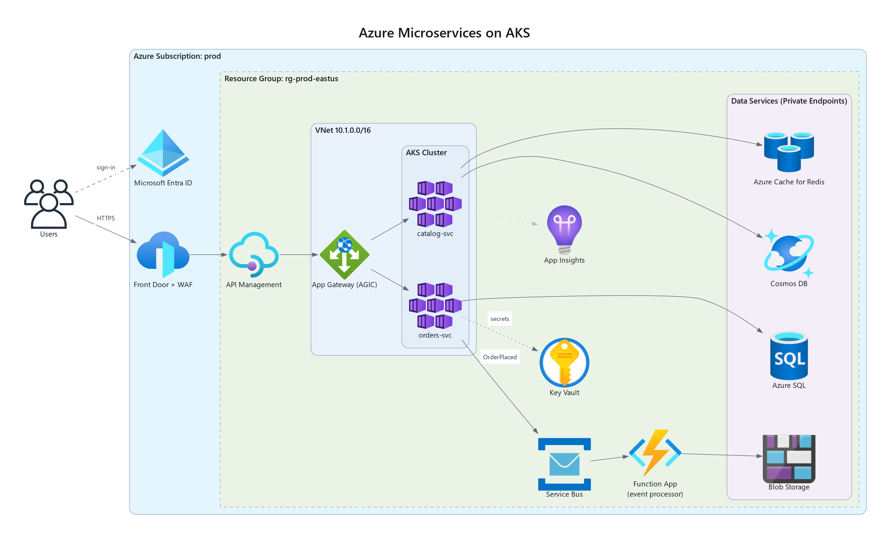
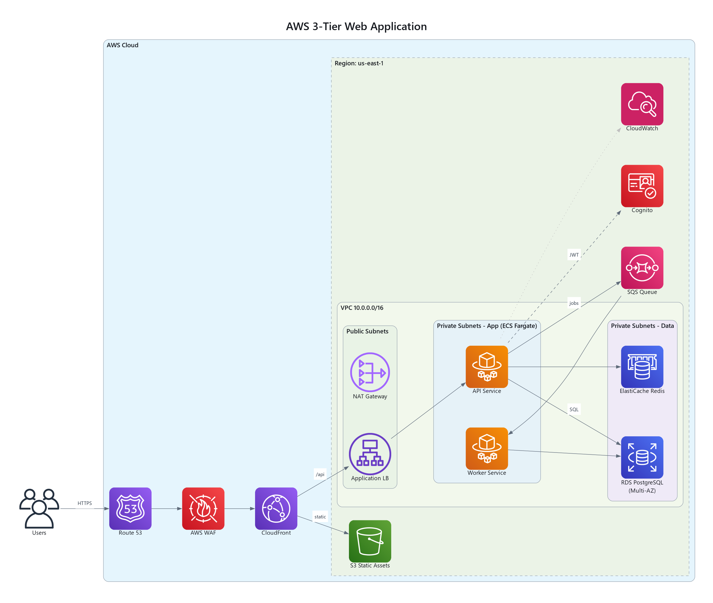
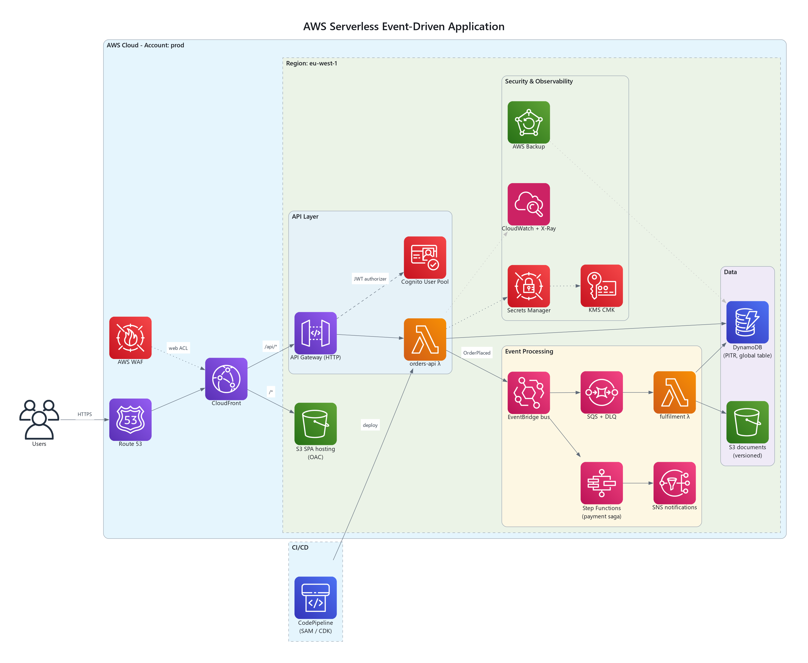
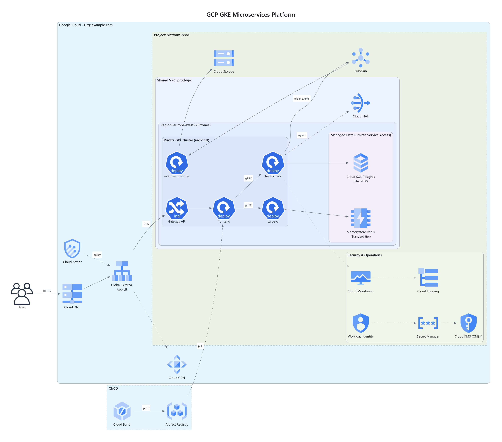
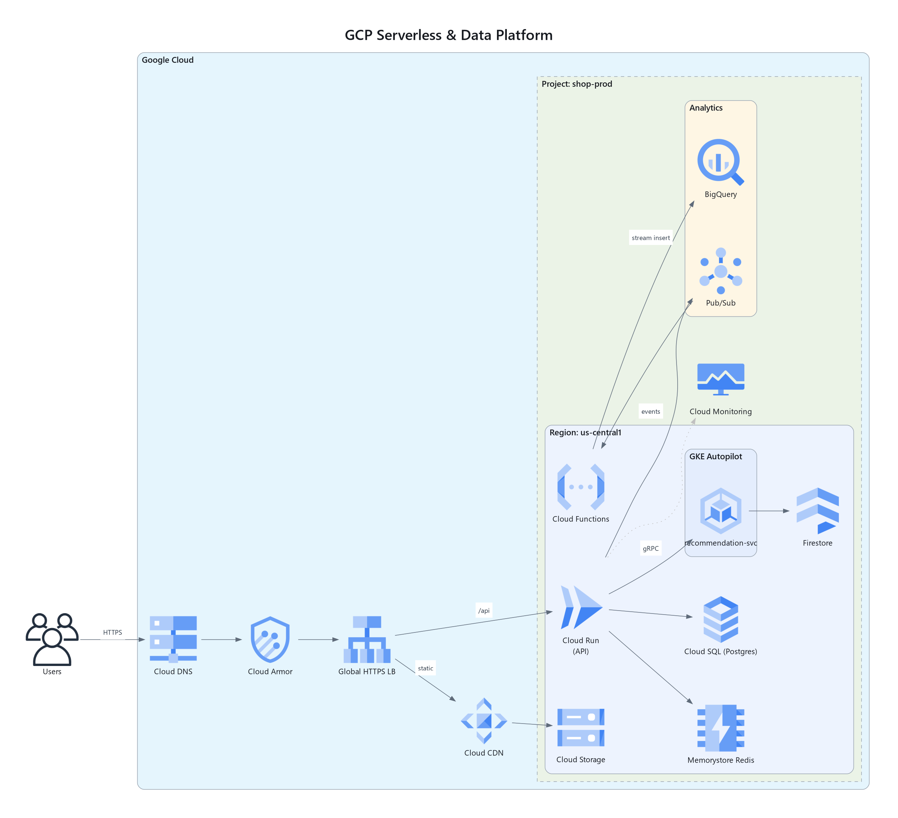
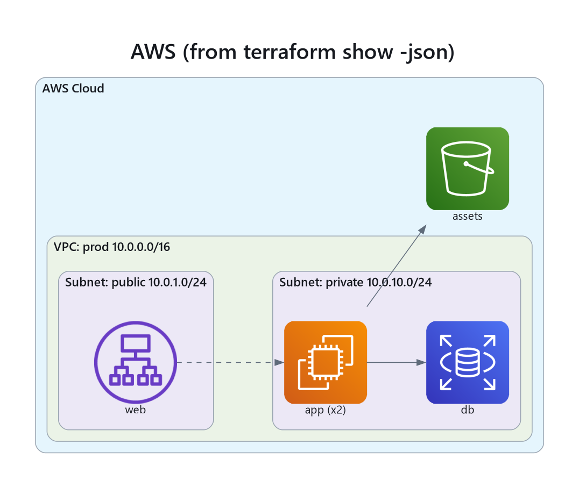

# Architecture Diagram MCP Server

`arch-diagram-mcp` is an MCP server that generates, reviews and imports cloud architecture diagrams for
**AWS, Azure and Google Cloud**. It uses the official provider icons, about 1,800 in all, including
Kubernetes, on-prem and SaaS services such as PostgreSQL, Redis, Kafka and Nginx. Diagrams render
through Graphviz to PNG, self-contained SVG, PDF or JPG.

## Samples

These are the bundled templates and the Terraform example, rendered exactly as the server produces them.
The score is from `review_architecture`. Click a diagram for the full-size image.

<table>
<tr>
<td width="50%"><a href="docs/samples/azure_webapp_hub_spoke.png"></a><br><b>Azure web app, hub-spoke with warm DR</b><br><code>azure_webapp_hub_spoke</code>, review 94 (A)</td>
<td width="50%"><a href="docs/samples/azure_aks_microservices.png"></a><br><b>Azure AKS microservices</b><br><code>azure_aks_microservices</code>, review 97 (A)</td>
</tr>
<tr>
<td><a href="docs/samples/aws_three_tier.png"></a><br><b>AWS three-tier web app</b><br><code>aws_three_tier</code>, review 86 (B)</td>
<td><a href="docs/samples/aws_serverless_event_driven.png"></a><br><b>AWS serverless, event-driven</b><br><code>aws_serverless_event_driven</code>, review 100 (A)</td>
</tr>
<tr>
<td><a href="docs/samples/gcp_gke_microservices.png"></a><br><b>GCP GKE microservices</b><br><code>gcp_gke_microservices</code>, review 97 (A)</td>
<td><a href="docs/samples/gcp_serverless_data.png"></a><br><b>GCP serverless and data platform</b><br><code>gcp_serverless_data</code>, review 81 (B)</td>
</tr>
<tr>
<td><a href="docs/samples/terraform_aws_plan.png"></a><br><b>Imported from Terraform</b><br><code>diagram_from_terraform</code> on <a href="examples/aws_plan.json">examples/aws_plan.json</a>, review 73 (C)</td>
<td></td>
</tr>
</table>

To regenerate them, run `python scripts/render_samples.py`.

The server has also been tested end to end on Google Cloud: a private bucket with signed URLs, and a
private Cloud Run service with two layers of auth. See [docs/CLOUD_TESTING.md](docs/CLOUD_TESTING.md) for
how it was tested, what was checked and the bug it found.

## Tools

| Tool | What it does |
|------|--------------|
| `search_icons(query, provider?, limit?)` | Ranked icon search by service name or alias (`ecs`, `s3`, `aks`, `cloud run`, `redis`) |
| `list_icon_categories(provider)` | Lists every category and service for a provider |
| `list_templates(provider?)` / `get_template(id)` | Returns bundled reference architectures as editable specs |
| `validate_diagram(spec)` | Checks a spec without rendering: icon ids (with suggestions), references, nesting cycles, limits |
| `generate_architecture_diagram(spec)` | Renders the diagram; returns file paths, a JSON summary and an inline PNG preview |
| `review_architecture(spec)` | Runs a heuristic Well-Architected review and returns a 0–100 score, a grade and findings with recommendations |
| `diagram_from_terraform(title, terraform_json \| path, ...)` | Builds a diagram from `terraform show -json` output (plan or state) or a raw `.tfstate` file |
| `server_info()` | Reports the version, Graphviz status, icon count, output directory and limits |

There is also one prompt, `design_architecture(provider, workload, requirements)`. It walks the model
through choosing a template, searching icons, validating, rendering and reviewing.

### Bundled templates
- `aws_three_tier`
- `aws_serverless_event_driven`
- `azure_webapp_hub_spoke`
- `azure_aks_microservices`
- `gcp_serverless_data`
- `gcp_gke_microservices`

Every template is tested to validate, to render, and to have no critical- or high-severity review findings.

### Diagram spec
```json
{
  "title": "My App",
  "direction": "LR",
  "theme": "light",
  "output_formats": ["png", "svg"],
  "clusters": [{"id": "vpc", "label": "VPC 10.0.0.0/16"}, {"id": "app", "label": "Private subnet", "parent": "vpc"}],
  "nodes": [{"id": "api", "type": "aws.compute.ECS", "label": "orders-api", "cluster": "app"}],
  "edges": [{"source": "alb", "target": "api", "label": "HTTPS", "style": "dashed"}]
}
```

### Review rules
| Pillar | Rules |
|--------|-------|
| Security | Internet → data store (critical); internet → compute without a gateway (high); no WAF; no secrets/KMS; no identity provider; data stores outside a network boundary; no egress control |
| Reliability | VM without a load balancer; single region; no backup; deep synchronous call chains |
| Operational Excellence | No monitoring; no CI/CD; unconnected components |
| Performance Efficiency | No CDN for public traffic; no cache layer |

The rules only see what the diagram shows. Treat findings as review prompts, not proof of a
misconfiguration.

### Terraform import
`terraform show -json plan.out > plan.json` gives the best result, because the plan includes the
configuration's references.

- **Mapped resources:** about 140 AWS, Azure and GCP resource types become nodes.
- **Boundaries:** VPC/VNet, subnet, resource group and Container Apps environment resources become
  nested clusters. Nodes are placed in the most specific boundary they reference, either directly or
  through a NIC.
- **Edges:** references between resources become edges, and module outputs are resolved.
- **Inferred edges:** links that pass through plumbing resources become dashed edges, oriented
  edge → compute → messaging → data. Plumbing resources include listeners, target groups, NICs, role
  assignments, Front Door origins and backend services.
- **Unmapped types:** the result lists them, so you can see what was left out.

## Install

Requires Python 3.11+ and Graphviz.

```powershell
winget install Graphviz.Graphviz        # Linux: apt install graphviz   macOS: brew install graphviz
python -m venv .venv
.venv\Scripts\python -m pip install -e ".[dev]"
.venv\Scripts\python -m pytest            # 69 tests
```

### Register with Claude Code (stdio)
```powershell
claude mcp add architecture-diagrams -s user `
  -e ARCH_DIAGRAM_OUTPUT_DIR=C:\Devops-Projects\Architecture-diagram-mcp\output `
  -- C:\Devops-Projects\Architecture-diagram-mcp\.venv\Scripts\python.exe -m arch_diagram_mcp
```

### Run as a shared HTTP service
```bash
docker build -t arch-diagram-mcp:1.1.0 .
docker run -d -p 8000:8000 -v diagrams:/data \
  -e ARCH_DIAGRAM_AUTH_TOKENS="ci=$(openssl rand -hex 32),platform-team=$(openssl rand -hex 32)" \
  -e ARCH_DIAGRAM_PUBLIC_BASE_URL=https://diagrams.internal.example.com \
  -e ARCH_DIAGRAM_URL_SIGNING_KEY=$(openssl rand -hex 32) \
  -e ARCH_DIAGRAM_ALLOWED_HOSTS="diagrams.internal.example.com:*" \
  arch-diagram-mcp:1.1.0
```
Clients connect to `https://<host>/mcp` with `Authorization: Bearer <token>`. `GET /healthz` is
unauthenticated and works as a probe. The server runs stateless, so it scales horizontally behind a
load balancer. All replicas must share `ARCH_DIAGRAM_URL_SIGNING_KEY` so any replica can serve any link.

### Authentication
| Mode | Set | Identity in audit logs | Roles |
|------|-----|------------------------|-------|
| `token` | `ARCH_DIAGRAM_AUTH_TOKENS="name=secret,..."` | the token's name | Full access |
| `oidc` | `ARCH_DIAGRAM_OIDC_ISSUER` + `ARCH_DIAGRAM_OIDC_AUDIENCE` | `preferred_username` / `upn` / `email`, keyed by `oid`/`sub` | `ARCH_DIAGRAM_READER_ROLE`, `ARCH_DIAGRAM_AUTHOR_ROLE` |

**Token mode.** Several named tokens can be active at once. To rotate, add the new token, roll out
clients, then remove the old one. Each token must be at least 16 characters.

**OIDC mode.** The server validates JWTs against the issuer's published signing keys (JWKS, found by
discovery or set with `ARCH_DIAGRAM_OIDC_JWKS_URI`). It checks:
- signature (asymmetric algorithms only: no HS*, no `none`);
- `iss` and `aud`;
- `exp` and `nbf`, with 60 s leeway;
- optional `ARCH_DIAGRAM_OIDC_REQUIRED_SCOPES`.

Roles come from the `roles` claim (Entra app roles) and the `scp` scope claim:
- **Reader:** search, templates, validate, review.
- **Author:** also render and import Terraform. Author implies Reader.
- If neither role variable is set, any valid token gets full access.

The server publishes RFC 9728 metadata at `/.well-known/oauth-protected-resource`, and every 401
response points to it, so MCP clients can discover the authorization server.

Entra ID example:
1. Register an API app with Application ID URI `api://arch-diagrams`.
2. Set `accessTokenAcceptedVersion: 2` in its manifest.
3. Add app roles `Diagrams.Reader` and `Diagrams.Author`, and assign them to groups.
4. Configure the server:
```bash
ARCH_DIAGRAM_OIDC_ISSUER=https://login.microsoftonline.com/<tenant-id>/v2.0
ARCH_DIAGRAM_OIDC_AUDIENCE=api://arch-diagrams      # v2 tokens may carry the app's client id instead; list both
ARCH_DIAGRAM_READER_ROLE=Diagrams.Reader
ARCH_DIAGRAM_AUTHOR_ROLE=Diagrams.Author
```
Entra ID has no dynamic client registration. Clients either use a pre-registered client app, or pass
a token they already hold, e.g. `az account get-access-token --resource api://arch-diagrams`.

### Artifact storage
Over HTTP, responses contain download **URLs** instead of server file paths:

| `ARCH_DIAGRAM_STORAGE` | Links | Credentials |
|------------------------|-------|-------------|
| `local` (default) | `https://<PUBLIC_BASE_URL>/artifacts/<file>?exp=..&sig=..`, served by this server and HMAC-signed | `ARCH_DIAGRAM_URL_SIGNING_KEY` |
| `s3` | SigV4 presigned GET; objects encrypted with SSE-S3, or SSE-KMS when `ARCH_DIAGRAM_S3_KMS_KEY_ID` is set | Standard AWS chain (IRSA, instance role, env, profile) |
| `azure` | Read-only, HTTPS-only SAS. Uses a user-delegation key via Entra ID with `ARCH_DIAGRAM_AZURE_ACCOUNT_URL`, or an account key via `AZURE_STORAGE_CONNECTION_STRING` | Managed / workload identity needs *Storage Blob Data Contributor* |
| `gcs` | V4 signed URL. Signs locally with a service-account key, or through IAM signBlob under workload identity | Needs *Storage Object Creator* and *Service Account Token Creator* |

- **Object keys:** `<prefix>/<yyyy>/<mm>/<dd>/<sha256(caller)[:16]>/<file>`. Files are separated per
  caller, and keys never contain user names.
- **Link lifetime:** set by `ARCH_DIAGRAM_URL_TTL_S`, default 1 h, maximum 7 days.
- **Cleanup:** `ARCH_DIAGRAM_DELETE_LOCAL_AFTER_UPLOAD=true` removes local copies once a cloud upload
  succeeds. For cloud objects, use a bucket lifecycle rule.
- **Served SVGs:** sent with `Content-Security-Policy: sandbox` and `nosniff`.
- **Terraform paths:** `diagram_from_terraform(path=...)` is disabled over HTTP, so remote callers
  can't read server files.

## Configuration (environment)

| Variable | Default | Purpose |
|----------|---------|---------|
| `ARCH_DIAGRAM_OUTPUT_DIR` | `~/architecture-diagrams` | Where diagrams are written |
| `ARCH_DIAGRAM_INPUT_ROOTS` | cwd + output dir | `os.pathsep`-separated directories that `diagram_from_terraform(path=...)` may read |
| `ARCH_DIAGRAM_MAX_NODES` / `_MAX_EDGES` / `_MAX_CLUSTERS` | 300 / 800 / 100 | Spec size limits |
| `ARCH_DIAGRAM_RENDER_TIMEOUT_S` | 60 | Graphviz is killed after this many seconds |
| `ARCH_DIAGRAM_MAX_TERRAFORM_BYTES` | 25 MB | Terraform input size limit |
| `ARCH_DIAGRAM_RETENTION_DAYS` | 0 (keep forever) | Deletes generated files older than N days |
| `ARCH_DIAGRAM_KEEP_DOT_SOURCE` | true | Keeps the `.dot` file for hand-editing |
| `ARCH_DIAGRAM_INLINE_PNG_MAX_BYTES` | 4 MB | Larger PNGs are returned as a path only |
| `ARCH_DIAGRAM_FONT` | auto | Font family; auto picks Segoe UI on Windows, Helvetica Neue on macOS, DejaVu Sans on Linux |
| `ARCH_DIAGRAM_PNG_DPI` | 144 | PNG/JPG resolution (72–300) |
| `ARCH_DIAGRAM_LOG_LEVEL` | INFO | JSON logs go to stderr, one audit line per tool call |
| `ARCH_DIAGRAM_HTTP_HOST` / `_HTTP_PORT` | 127.0.0.1 / 8000 | HTTP bind address and port |
| `ARCH_DIAGRAM_AUTH_MODE` | auto | `none` / `token` / `oidc`; inferred from the variables below |
| `ARCH_DIAGRAM_AUTH_TOKENS` | – | `name=secret,...` named bearer tokens (the legacy single `ARCH_DIAGRAM_AUTH_TOKEN` still works) |
| `ARCH_DIAGRAM_OIDC_ISSUER` / `_OIDC_AUDIENCE` / `_OIDC_JWKS_URI` / `_OIDC_REQUIRED_SCOPES` | – | OIDC validation |
| `ARCH_DIAGRAM_READER_ROLE` / `_AUTHOR_ROLE` | – | Role names for RBAC (OIDC) |
| `ARCH_DIAGRAM_PUBLIC_BASE_URL` | – | External URL; used for download links and OAuth metadata |
| `ARCH_DIAGRAM_STORAGE` | local | `local` / `s3` / `azure` / `gcs` |
| `ARCH_DIAGRAM_STORAGE_BUCKET` / `_STORAGE_PREFIX` | – / `diagrams/` | Bucket or container, and key prefix |
| `ARCH_DIAGRAM_S3_REGION` / `_S3_KMS_KEY_ID` / `_AZURE_ACCOUNT_URL` | – | Backend specifics |
| `ARCH_DIAGRAM_URL_TTL_S` | 3600 | Download-link lifetime (60 s – 7 days) |
| `ARCH_DIAGRAM_URL_SIGNING_KEY` | random per process | HMAC key for local links; ≥32 chars; share it across replicas |
| `ARCH_DIAGRAM_DELETE_LOCAL_AFTER_UPLOAD` | false | Removes local files after a cloud upload |
| `ARCH_DIAGRAM_ALLOWED_HOSTS` / `_ALLOWED_ORIGINS` | – | Comma-separated Host/Origin allow-lists (DNS-rebinding protection) |
| `ARCH_DIAGRAM_ALLOW_UNAUTHENTICATED` | false | Allows a non-loopback bind without a token (only behind an authenticating proxy) |

## Security model
- **Spec validation:** ids, colours and styles are pattern-checked, and size limits apply.
- **Text escaping:** titles, node labels and cluster labels are always written as literal strings,
  never as Graphviz HTML labels. Edge labels are HTML-escaped. A label therefore can't inject DOT
  statements, such as an `image=` attribute that reads local files.
- **Rendering:** Graphviz runs as a subprocess with a hard timeout, and partial output is deleted on
  failure.
- **Output files:** file names are sanitised, timestamped and uniquely suffixed. Retention cleanup only
  touches files the server generated.
- **Terraform input:** file reads are confined to `ARCH_DIAGRAM_INPUT_ROOTS` and size-limited.
- **HTTP:**
  - Static tokens are compared in constant time against every configured token.
  - OIDC JWTs are fully validated, and key-confusion and `alg: none` tokens are rejected (both are
    tested).
  - Per-tool RBAC applies, and every audit line records the caller.
  - The server refuses to bind to a public address without authentication.
  - DNS-rebinding protection uses Host/Origin allow-lists.
  - The container runs as a non-root user.
- **SVG output:** icons are embedded, so the files don't leak local paths and render anywhere.

## Layout
```
src/arch_diagram_mcp/
  server.py        MCP tools, prompt, error mapping, audit logging
  catalog.py       icon index, alias resolution, ranked search, suggestions
  models.py        spec schema + semantic validation
  renderer.py      Graphviz source build, timed subprocess render, themes, SVG inlining, retention
  review.py        Well-Architected heuristic rules and scoring
  terraform.py     Terraform plan/state -> spec
  template_library.py + templates/*.json   reference architectures
  auth.py          principals, static-token + OIDC authenticators, RBAC
  storage.py       local signed links, S3 / Azure Blob / GCS uploads with signed URLs
  http_app.py      streamable-HTTP app, auth middleware, OAuth resource metadata, /artifacts, /healthz
  config.py, logs.py, __main__.py
tests/             70 tests: catalog, validation, rendering, label injection, review, Terraform, MCP tools,
                   HTTP auth, OIDC (incl. attack tokens), RBAC, signed links, S3 (moto), Azure SAS, GCS V4
docs/CLOUD_TESTING.md   how the server was tested on real Google Cloud
docs/samples/      rendered sample diagrams shown above
scripts/render_samples.py   regenerates docs/samples/
scripts/e2e_cloud.py, run_impersonated.py   real-cloud end-to-end test tools
```
