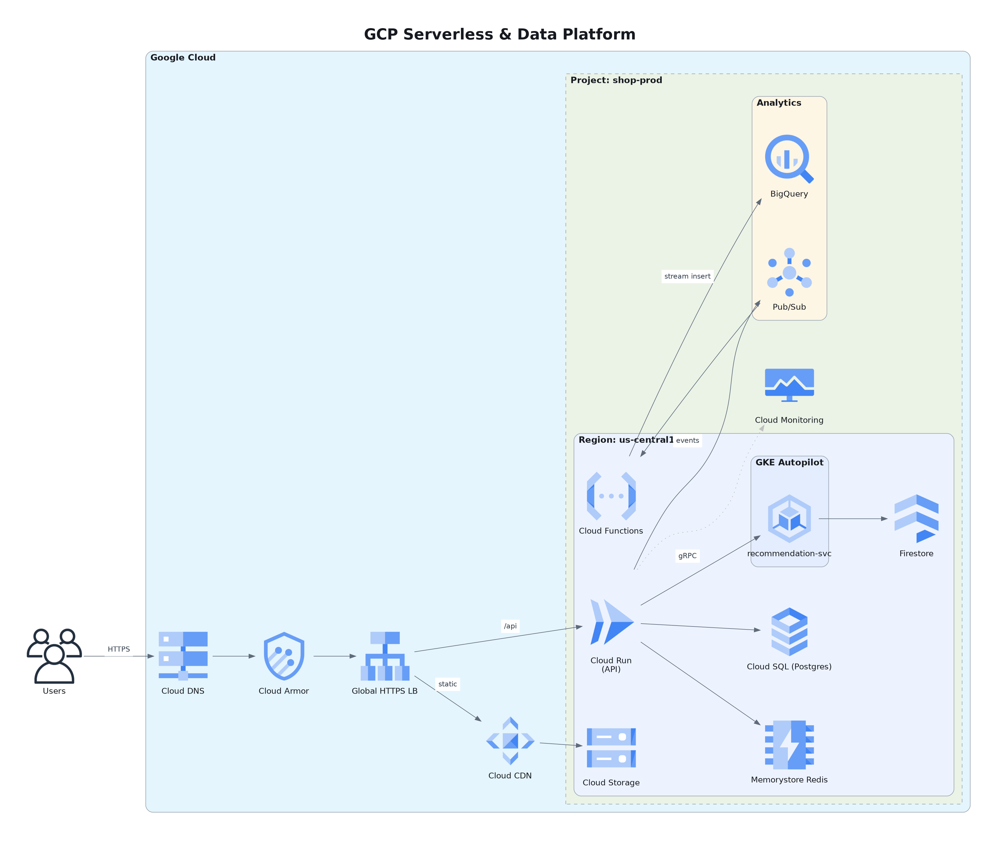

# Testing on a real cloud provider (Google Cloud)

The unit tests use stubs for cloud storage: moto for S3, a stubbed upload for Azure Blob, and a locally
generated key for GCS. Stubs can't prove that signed URLs, IAM and managed identities behave the same
way in a real cloud. So version 1.1.x was also tested end to end on **Google Cloud**: first a local
server writing to a real bucket, then the container deployed to **Cloud Run**.

This document describes how the test ran, what it checked, what it found and how to repeat it.
Identifiers (project, accounts, bucket, hostnames) are shown as placeholders. Every resource was
deleted after the run.

Version 1.2.0's inventory import was built and tested against a live platform the same way; see
[Inventory import against a running platform](#inventory-import-against-a-running-platform-120).

| | |
|---|---|
| Date | 2026-10-27 |
| Server version | 1.1.0 found the bug, 1.1.1 passed |
| Storage | Google Cloud Storage, V4 signed URLs |
| Hosting | Cloud Run (container built by Cloud Build from this repo's `Dockerfile`) |
| Client | The official MCP Python SDK client over streamable HTTP ([scripts/e2e_cloud.py](../scripts/e2e_cloud.py)) |
| Result | Local + GCS: **15/15 passed**. Cloud Run: **19/19 passed** after one fix |

## Sample rendered in the cloud

This diagram was rendered by the server running on Cloud Run, uploaded to the private bucket, and
downloaded through the V4 signed URL the server returned. It is the bundled `gcp_serverless_data`
template.



The Cloud Run image renders with Debian's Graphviz 2.42 and DejaVu Sans. The output matches what
Windows renders with Graphviz 16 and Segoe UI: official icons, anti-aliased text, readable edge labels.

## What was built

All resources lived in one test project, carried a `purpose=archdiag-test` label, and were deleted at
the end. Access was kept to the minimum:

| Resource | Purpose | Access granted |
|---|---|---|
| Storage bucket | Diagram output | Uniform bucket-level access, **public access prevention enforced**, lifecycle rule deleting objects after 1 day |
| Runtime service account | Identity of the server | `roles/storage.objectUser` **on that bucket only**; `roles/iam.serviceAccountTokenCreator` on itself, so it can sign URLs via IAM signBlob; `roles/secretmanager.secretAccessor` on the token secret only |
| Build service account | Identity for Cloud Build | Read the build-source bucket, write to the one Artifact Registry repository, write logs. Used **instead of** granting more to the project's default Compute service account |
| Artifact Registry repository | Container image | Private |
| Secret Manager secret | The server's bearer token (`ARCH_DIAGRAM_AUTH_TOKENS`) | Readable only by the runtime service account. The token was never stored in a plain environment variable |
| Cloud Run service | The MCP server | **Private** (`--no-allow-unauthenticated`), min 0 / max 2 instances, 1 vCPU, 1 GiB |

### Two layers of authentication on Cloud Run

The service was not made public. Every request has to pass two independent checks:

1. **Google IAM at the Cloud Run front door.** The caller presents a Google identity token in the
   `X-Serverless-Authorization` header and needs `roles/run.invoker`.
2. **The server's own bearer token**, in the standard `Authorization` header. Cloud Run passes it
   through untouched when the IAM token travels in `X-Serverless-Authorization`.

The server also set `ARCH_DIAGRAM_ALLOWED_HOSTS` to the service's hostname, so its DNS-rebinding
protection was tested behind Google's front end.

## Stage 1: local server, real bucket

The real `arch-diagram-mcp --transport http` entry point ran on a workstation with these settings:

```
ARCH_DIAGRAM_STORAGE=gcs
ARCH_DIAGRAM_STORAGE_BUCKET=<bucket>
ARCH_DIAGRAM_URL_TTL_S=60                     # short, so expiry can be tested
ARCH_DIAGRAM_AUTH_TOKENS=e2e=<random token>
ARCH_DIAGRAM_DELETE_LOCAL_AFTER_UPLOAD=true
```

No service-account key was created. [scripts/run_impersonated.py](../scripts/run_impersonated.py) gave
the server **impersonated credentials** for the runtime service account, sourced from a short-lived
user token. The workstation's Application Default Credentials were left untouched.

## Stage 2: Cloud Run

1. **Build.** Cloud Build built the repository's `Dockerfile` as the build service account and pushed
   it to Artifact Registry. This was the first full build of the image; it took about 1 minute 40
   seconds.
2. **Deploy.** The image ran as the runtime service account, with the token from Secret Manager:

   ```bash
   gcloud run deploy <service> \
     --image <region>-docker.pkg.dev/<project-id>/<repo>/arch-diagram-mcp:1.1.1 \
     --region <region> --service-account <runtime-sa> \
     --set-env-vars ARCH_DIAGRAM_STORAGE=gcs,ARCH_DIAGRAM_STORAGE_BUCKET=<bucket>,ARCH_DIAGRAM_URL_TTL_S=60,ARCH_DIAGRAM_DELETE_LOCAL_AFTER_UPLOAD=true,ARCH_DIAGRAM_ALLOWED_HOSTS=<service-host> \
     --set-secrets ARCH_DIAGRAM_AUTH_TOKENS=<secret-name>:latest \
     --port 8000 --memory 1Gi --cpu 1 --min-instances 0 --max-instances 2 \
     --no-allow-unauthenticated
   ```

   On Cloud Run there is no key file and no impersonation. The server signs URLs with the service's
   own metadata-server credentials, through the IAM signBlob API. Stage 1 could not exercise that path.

## What the test client checked

[scripts/e2e_cloud.py](../scripts/e2e_cloud.py) uses the official MCP SDK client. It calls `server_info`,
fetches the `gcp_serverless_data` template, renders it to PNG and SVG with `generate_architecture_diagram`,
and then attacks the results:

| # | Check | Expected | Local | Cloud Run |
|---|---|---|---|---|
| 1 | Request without a Google identity | Refused by Cloud Run IAM | n/a | ✅ 403 |
| 2 | Request without the server's bearer token | Refused by the server | ✅ 401 | ✅ 401 |
| 3 | Request with a wrong bearer token | Refused by the server | not run | ✅ 401 |
| 4 | Valid token, but a hostname not in the allow-list | DNS-rebinding protection | not run | ✅ 421 |
| 5 | `server_info` reports the cloud backend and the caller | `storage: gcs`, caller named from the token | ✅ | ✅ |
| 6 | Render a 15-node, 14-edge diagram | Succeeds | ✅ 3.8 s | ✅ 2.6 s |
| 7 | No server file paths in the result over HTTP | `files` absent | ✅ | ✅ |
| 8 | Signed URLs for PNG, SVG and DOT source | All three returned | ✅ | ✅ |
| 9–11 | Download each signed URL | HTTP 200, correct magic bytes and `Content-Type` (`image/png`, `image/svg+xml`, `text/vnd.graphviz`) | ✅ | ✅ |
| 12–14 | Same URLs with one character of the signature changed | Rejected by Cloud Storage | ✅ 403 | ✅ 403 |
| 15–17 | The object URL with the signature removed | The bucket is private | ✅ 403 | ✅ 403 |
| 18 | Download again after the 60 s lifetime | Expired link rejected | ✅ 400 | ✅ 400 |

Two more checks ran outside the client:

- **Audit log.** Every tool call produced a JSON audit line naming the caller, tool, outcome and duration:

  ```json
  {"logger": "arch_diagram_mcp.audit", "msg": "tool_call", "tool": "generate_architecture_diagram",
   "principal": "e2e", "subject": "token:e2e", "auth": "token", "nodes": 15, "edges": 14,
   "outcome": "ok", "duration_ms": 3808}
  ```

- **No local leftovers.** With `ARCH_DIAGRAM_DELETE_LOCAL_AFTER_UPLOAD=true`, the output directory was
  empty after the uploads.

## Bug found: signed URLs failed on Cloud Run (fixed in 1.1.1)

Stage 1 passed, but on Cloud Run every render failed after the upload:

```
GCS upload to gs://<bucket>/diagrams/... failed: Error calling the IAM signBytes API:
403 "Request had insufficient authentication scopes." reason: ACCESS_TOKEN_SCOPE_INSUFFICIENT
method: google.iam.credentials.v1.IAMCredentials.SignBlob
```

**Cause.** `google.cloud.storage.Client()` requests storage-only OAuth scopes. On Cloud Run (and GKE),
the metadata server then issues a token limited to those scopes. That token can upload objects, but
signing a V4 URL calls the IAM Credentials API, which needs the `cloud-platform` scope. Locally the
impersonated credentials already had `cloud-platform`, which is why stage 1 passed.

**Fix.** `GCSStore` now builds its default credentials with
`google.auth.default(scopes=["https://www.googleapis.com/auth/cloud-platform"])` (see
[storage.py](../src/arch_diagram_mcp/storage.py)). The regression test
`test_gcs_default_credentials_request_cloud_platform_scope` keeps it that way. After rebuilding and
redeploying 1.1.1, all 19 checks passed.

This failure mode only shows up on real cloud infrastructure, which is why this test was worth running.

## Cleanup

Everything was deleted after the run and the deletion was verified:

- the Cloud Run service, the secret, the Artifact Registry repository;
- the diagram bucket and the bucket Cloud Build created for build source;
- both service accounts, after removing their project-level role binding;
- the Cloud Run, Cloud Build and Secret Manager APIs, which had been enabled for the test, were
  disabled again.

Afterwards the project contained no buckets and no service accounts apart from Google's default
Compute service account. The local token files and test output were deleted too.

## Repeating the test

1. Create the bucket, the service accounts and the IAM bindings from the table above. Grant yourself
   `roles/iam.serviceAccountTokenCreator` on the runtime service account for stage 1.
2. **Stage 1.** Start the server with [scripts/run_impersonated.py](../scripts/run_impersonated.py) and
   the settings above, then run:

   ```bash
   python scripts/e2e_cloud.py http://127.0.0.1:8000/mcp <token> --wait-expiry 70
   ```

3. **Stage 2.** Build and deploy as above. Then run the client with the IAM header and the
   non-allow-listed hostname:

   ```powershell
   $env:E2E_EXTRA_HEADERS = '{"X-Serverless-Authorization": "Bearer ' + (gcloud auth print-identity-token) + '"}'
   $env:E2E_ALT_URL = "https://<other-hostname-of-the-service>/mcp"
   python scripts/e2e_cloud.py https://<service-host>/mcp <token> --wait-expiry 70
   ```

   Cloud Run serves each service under two hostnames. Put one in `ARCH_DIAGRAM_ALLOWED_HOSTS` and use
   the other as `E2E_ALT_URL`.

4. Delete everything. The cost of a run is a few cents.

## Inventory import against a running platform (1.2.0)

`diagram_from_inventory` was written against what Cloud Asset Inventory really returns, not against
the documentation's idea of it. A small but realistic platform was deployed into a test project, its
inventory was exported, and the importer was built and checked against that export.

**The platform** (created with `gcloud` and `kubectl`, the way many real platforms are, not Terraform):

| Layer | Resources |
|---|---|
| Network | Custom VPC, two subnets, Private Service Access range and peering, Serverless VPC Access connector |
| Edge | Global external HTTP load balancer: forwarding rule, proxy, URL map with a `/static/*` path rule, backend service on a serverless NEG, CDN-enabled backend bucket |
| Compute | Three Cloud Run services (one with direct VPC egress, one through the connector), GKE Autopilot with a `shop` namespace running a Deployment and a CronJob, a VM |
| Data | Cloud SQL for PostgreSQL (private IP), Memorystore for Redis, a bucket, a BigQuery dataset |
| Integration | Pub/Sub topic with a push subscription and a dead-letter topic, a Cloud Scheduler job |
| Security and delivery | A Secret Manager secret, a dedicated runtime service account, an Artifact Registry repository |

Connections were set the way teams usually set them: Cloud SQL in a Cloud Run annotation, the secret
as a `secretKeyRef`, the topic path and another service's URL in environment variables, and the Redis
IP in a GKE workload's `REDIS_HOST`. Cloud Armor could not be created because the test project's quota
for security policies is 0, so it is covered by a unit test instead.

**What the real export showed**, and what the importer does about it:

| Observation | Handling |
|---|---|
| 1,002 assets for about 25 real resources: GKE system objects, RBAC, routes, and the auto-created `default` network with 40+ subnets | Noise types are ignored; empty boundaries are dropped; GKE system namespaces are skipped |
| The same project appears as an ID in some names and a number in others (secrets, VPC connectors) | Numbers are mapped to IDs, from the Project asset or by pairing names with ancestors |
| References come in many forms: full URLs, `projects/...` paths, bare names, `project:region:instance`, service URLs, IPs | One resolver handles each form; Cloud Run services are found from the URLs they list |
| Five region-scoped type names (`RegionUrlMap` and others) are rejected by the API | Removed; regional variants are reported under the global type names |
| The full export is 4.4 MB | `--asset-types "$(arch-diagram-mcp --gcp-asset-types)"` cuts it to 535 KB with an identical diagram |
| The test project also held unrelated resources (a VM in the `default` network) | Correctly drawn when unfiltered and excluded by `labels: {"app": "shop"}` |

**Result.** From the full live export, through a real MCP client over stdio, the tool produced 20
resources with their real names and 13 connections, every one of them backed by configuration. With
`labels={"app": "shop"}` it produced 18 resources and the same 13 connections, in about one second.
The sample in the [README gallery](../README.md#samples) is that diagram, rendered from the sanitised
export.

The export is kept, with identifiers replaced, as
[tests/fixtures/gcp_inventory_shop.json](../tests/fixtures/gcp_inventory_shop.json). Tests assert every
node's placement and the exact set of edges against it, so later changes are checked against real
data. Further unit tests cover what the platform did not include: Cloud Functions gen2, Cloud Armor,
managed instance groups, Eventarc, Shared VPC, and the `gcloud asset export` and
`search-all-resources` formats.

Everything was deleted afterwards. The test project's own unrelated resources were left untouched.

## Not yet tested on a real provider

- **Inventory import for Azure and AWS** (Resource Graph, AWS Config / Resource Explorer): not built yet.
- **Azure Blob Storage** (SAS by account key and by user delegation key with managed identity) and
  **Amazon S3** (SigV4 presigned URLs, SSE-KMS). Both have unit tests only. The same script works
  against them: change `ARCH_DIAGRAM_STORAGE` and the hosting platform.
- **OIDC with a real identity provider** (Entra ID, Google, Okta), including role-based access. The
  tests use locally generated keys and forged tokens.
